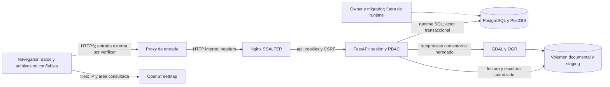

# Auditoría de ciberseguridad — Software-PA / SSALFER

Fecha: 2026-10-27 (America/Mexico_City). Rama `dev`. SHA `683ff75613768de28a7127c7e33a6e2ef4fc40ff`. Diagnóstico no destructivo.

## Dictamen ejecutivo

**Riesgo global alto para autorizar un despliegue institucional con la evidencia disponible.** Existe un flujo de XSS almacenado en el mapa, confirmado por código y por ejecución aislada del sink; el procesamiento GIS comparte el ámbito del backend y no tiene presupuestos integrales. Se reconocen controles sólidos de sesiones, CSRF, RBAC y auditoría. No se confirma compromiso, filtración real ni vulnerabilidad crítica. Esta evaluación no acredita la configuración ni el estado del servidor.

12 observaciones: **0 críticas, 3 altas, 8 medias y 1 baja**. Estados excluyentes: **2 confirmadas por prueba aislada, 4 confirmadas por código, 4 riesgos de configuración y 2 potenciales**. Ninguna observación es una CVE aplicable confirmada. No se asigna un número CVSS 4.0: faltan reproducción integral, alcance real de impacto y controles ambientales para sostener un vector sin falsa precisión; cada severidad cualitativa se justifica con prerrequisitos e impacto.

### Respuestas a las preguntas de cierre

| Pregunta | Diagnóstico |
|---|---|
| ¿Autenticación con debilidades relevantes? | Sí: abuso distribuido/costo y bloqueo inducible sin throttling complementario visible (SS-04). No se demostró bypass de sesión, fallo de bcrypt ni omisión general de CSRF. |
| ¿Acceso fuera de alcance? | No se confirmó BOLA general en HTTP. Las relaciones y filtros restringen al operador. El documento compartido aplica permiso global a partir de un vínculo y requiere decisión funcional (SS-05). XSS podría actuar con el alcance de una víctima. |
| ¿Filtración documental o GIS? | Posible por XSS o interpretación de versiones compartidas; no hay filtración observada. Staging/revisiones están restringidos a admin/geógrafo y la cartografía publicada sigue el alcance de lectura. |
| ¿GDAL y cargas suficientemente aislados? | No según el diseño versionado: comparten usuario, entorno/secretos y almacenamiento del backend; cuotas incompletas (SS-02/03). No se afirma SSRF/RCE reproducida. |
| ¿Mínimo privilegio PostgreSQL? | Separación declarada adecuada y revocaciones útiles, pero grants amplios y actor confiado al runtime. ACL/owners/membresías/TEMP efectivos pendientes (SS-07). |
| ¿Docker adecuado para producción? | Requiere endurecimiento y una composición efectiva validada. Loopback, persistencia y prod sin reload son positivos; faltan UID no root, cuotas/aislamiento, digests y evidencia de TLS externo. |
| ¿Pruebas suficientes? | Cobertura funcional importante de roles, personas, documentos y concurrencia, pero faltan regresiones de XSS, presupuestos GIS, formatos hostiles y configuración productiva. Las suites DB no se ejecutaron. |
| ¿Qué impide afirmar preparación institucional? | SS-01/02/03, pruebas de aceptación pendientes, política documental compartida, ACL/infraestructura/TLS/backups/rulesets no verificados y escaneo completo de artefactos sin ejecutar. |

Confianza **alta en los hechos de código y pruebas acotadas**, **media en la valoración total** y **baja para extrapolar a producción**. La salida es un diagnóstico, no certificación ASVS ni declaración de cumplimiento.

## Alcance, identidad Git y exclusiones

Al inicio se ejecutaron únicamente `git status --short --branch`, `git rev-parse HEAD`, `git remote -v` y `git branch -avv`. Árbol limpio, rama dev y origin/dev local en el SHA indicado; coincide exactamente con la referencia suministrada. Remote origin corresponde al repositorio pedido mediante SSH Git, sin realizar conexión SSH. No se consultó frescura remota ni se modificaron referencias.

| Ref disponible localmente | SHA abreviado | Relación observada |
|---|---|---|
| dev / origin/dev | 683ff75 | Fuente principal de esta auditoría |
| feature/backend-logica / origin equivalente | 2183ab2 | Disponible; no se declara auditada íntegramente |
| feature/frontend-ssalfer-conectado | 36bdfec | Local tres commits detrás de su ref remota local 929fa13 |
| backup/frontend-ssalfer-antes-backend | 36bdfec | Referencia auxiliar |
| main | 7931748 | Local detrás de origin/main 469375d; no es fuente integrada |
| wip/generador-erd | 7809b96 | Otro worktree; fuera de alcance |
| origin/feature/integracion-mq-deploy | 683ff75 | Misma referencia auditada |
| origin/feature/migracion-mq-cierre | 4f94a48 | Disponible; fuera de auditoría integral |
| chore/retirar-react-vite-ssalfer-unico | No disponible | No se infiere contenido ni eliminación de React |

Se inspeccionaron los 36 archivos versionados bajo backend/app, con lectura enfocada en rutas, controles y servicios sensibles; análisis AST de los 129 Python versionados; inventario de 208 operaciones de negocio (207 handlers y un alias) por AST; revisión léxica de las 30 migraciones canónicas 001–030, lectura enfocada de autenticación/auditoría, privilegios, GIS y scripts; 88 JS propios con comprobación sintáctica y búsqueda de fuentes/sinks, módulos de sesión/usuarios/documentos/reportes/GIS y HTML de referencia; Compose, Dockerfiles, dependencias y pruebas señaladas. La revisión no es una prueba formal de todas las ramas ni una ejecución de todos los servicios. Los .pyc y cachés locales no son evidencia del commit. Un directorio vacío local con nombre `001_init_schema.sql` no es una migración: el runner comprueba `-f` y lo omite.

No hubo checkout/fetch/pull/reset/merge/rebase, commits, instalación, scanners externos, Docker, migraciones, seeds, API real, creación de usuarios/sesiones, BD, SSH de servidor ni despliegue. Sólo se crean estos seis informes. No se leen valores de .env ni se copian secretos o datos personales a los reportes. Las pruebas extraen funciones inspeccionadas o usan VM/DOM/API simulados. Las consultas web sólo obtuvieron documentación/advisories públicos; no enviaron archivos, código ni datos del repositorio.

### Frontend de referencia

SSALFER está integrado: `js/env.js` fija `/api`; su Nginx sirve HTML y reenvía a FastAPI; las evidencias de integración 2026-10-20 y sesiones 2026-10-21 ejercitan esos archivos. Es el frontend prioritario para la revisión. React/Vite permanece versionado (47 archivos) y construible como servicio `frontend` en Compose base/prod. `docker-compose.ssalfer.yml` añade `frontend_ssalfer`, no lo reemplaza. No hay evidencia suficiente para declarar React retirado, inaccesible en el entorno real o seguro por ser legado. Se revisó su superficie de despliegue/manifests; no se hizo auditoría completa de sus pantallas. La documentación ARQUITECTURA aún presenta React y MIGRACIONES menciona 029 aunque el árbol llega a 030: desactualización documental, no prueba del despliegue.

## Método y modelo de amenazas

Se siguieron objetivos de OWASP ASVS (autenticación, sesión, acceso, archivos, datos y configuración), Top 10 (acceso, inyección/XSS, configuración, integridad/logs) y API Top 10 (API1 BOLA, API2 auth, API3 propiedades, API4 recursos, API5 funciones, API8 configuración, API9 inventario, API10 consumo externo). Son marcos de organización; no se afirma verificación de todos sus requisitos ni de un nivel ASVS. Se usan CWE por mecanismo y fuentes primarias de advisories por versión/prerrequisito.

Evidencias: **C** código/configuración del SHA; **D** documentación y QA histórica, no reejecutada; **A** comprobación aislada actual; **H** hipótesis que requiere infraestructura, política o reproducción posterior. La ausencia de un control en texto no demuestra ausencia en el proxy/servidor. Los controles heredados de DB requieren comprobar permisos efectivos. Se priorizan confidencialidad, integridad, disponibilidad y trazabilidad.

### Inventario de componentes, activos y entradas

| Componente | Datos/activos y frontera | Entradas no confiables / dependencias |
|---|---|---|
| Navegador SSALFER | Formularios, identidad de sesión en memoria, cookie HttpOnly; datos recibidos no son HTML confiable | URL/query, campos API, ficheros, tooltips; Leaflet 1.9.4, SheetJS CE 0.20.3, ExcelJS 4.4.0, html2canvas 1.4.1, iconos locales |
| Nginx SSALFER | Sitio estático y proxy del mismo origen; confianza en entrada HTTPS externa | HTTP/headers, XFF, cuerpo; nginx:1.27-alpine; tiles OpenStreetMap desde navegador |
| FastAPI | Identidad autenticada, RBAC, transacciones, documentos; cookie y CSRF no son intercambiables | Form OAuth login, JSON/Pydantic, multipart, IDs, consultas, errores; 42 pins Python |
| GDAL/OGR | Parser nativo de datos hostiles dentro del backend | GPKG/SQLite, GeoJSON, KML, ZIP/SHP, CRS, metadatos de capas; apt gdal-bin/PROJ/versiones reales desconocidas |
| PostgreSQL/PostGIS | Personas/contactos, propiedad social, geometrías, convenios, pagos, expedientes, hashes de credenciales, sesiones/eventos y bitácora | SQL parametrizado del runtime; triggers, funciones y actor transaccional; postgis/postgis:15-3.3 |
| Volumen uploads | Documentos históricos y originales/staging GIS según pipeline | Nombres del cliente transformados y rutas generadas; backup debe coordinar con DB |
| Administración/build | Credenciales owner/runtime, pgAdmin, imagen y fuentes | dpage/pgadmin4 mutable, Docker daemon/CI/rulesets fuera de alcance efectivo |

No se enumeran registros de personas, nombres institucionales operativos ni cuentas reales. Catálogos territoriales/RAN son fuentes declaradas; no se certifica que todas las fixtures/capturas estén anonimizadas. Existe documentación y material QA versionado (incluidas capturas), que requieren clasificación de información antes de ampliar distribución.

Las fronteras principales son navegador→entrada, proxy→API, API→BD y parser→backend. La última no tiene aislamiento fuerte declarado. La IP de auditoría depende de la cadena proxy, no de un encabezado arbitrario. Los mapas externos revelan IP y teselas solicitadas al proveedor; no se identificó envío de cookies de sesión o de expedientes a ese dominio. Evaluar proveedor/política de privacidad con infraestructura, sin afirmar filtración de geometrías completas.

## Controles existentes y límites de evaluación

### Autenticación y sesión

- Bcrypt con salt aleatorio y coste por defecto de la biblioteca; límite de 72 bytes UTF-8 comprobado antes de checkpw; política de creación/cambio/restablecimiento de mínimo 8 caracteres, letra y dígito (`schemas.py:116–127`). No se halló truncamiento silencioso. No hay lista de contraseñas comprometidas ni MFA visible: mejoras a decidir para roles sensibles, no bypass confirmado.
- Tokens nuevos de 32 bytes aleatorios para sesión y CSRF en cada login, hashes SHA-256 almacenados y token_hash UNIQUE; no hay JWT reutilizable ni sesión en localStorage. Cambiar contraseña/correo y revocar sesiones usa transacciones; la propia contraseña actual se exige y el cambio revoca todas las sesiones. No hay límite declarado de sesiones simultáneas: decidir política y retención, no considerarlo por sí solo una vulnerabilidad.
- Cookies de sesión HttpOnly, Secure obligatorio si APP_ENV=production, SameSite lax/strict, `__Host-`, Path=/ y sin Domain; CSRF legible por diseño. Expiración absoluta y por inactividad en servidor; revocación individual/global; lectura de usuario activo en cada autenticación. Bloqueo se aplica a nuevos logins; no se revocan automáticamente sesiones ya válidas por errores de contraseña: decisión razonable que evita expulsión inducida.
- Middleware CSRF para POST/PUT/PATCH/DELETE bajo /api, compara cookie/header y hash enlazado a sesión con compare_digest y exige Origin permitido. Login exige Origin y crea tokens nuevos. Sin cookie, la llamada sigue a la dependencia que exige sesión. Logout anónimo es idempotente; con cookie pasa por CSRF. No se encontró ruta de escritura autenticada fuera de /api ni una omisión CSRF demostrada.
- CORS usa orígenes explícitos, con credenciales; no acepta comodín. Origin no sustituye throttling. SECRET_KEY se exige fuerte al iniciar, pero el mecanismo observado de sesión usa secretos aleatorios opacos, no firma con esa clave; no atribuirle garantías inexistentes.
- Proxy: `_request_ip` valida IP y sólo lee XFF si peer está en una lista exacta, pero selecciona el primer valor de una cadena. El Nginx concatena XFF. Uvicorn puede interpretar proxy headers según su configuración. Falta confirmar confianza y normalización de toda la cadena; no se comprobó spoofing. No se recomienda vincular sesiones rígidamente a IP sin analizar movilidad/NAT.
- FOR UPDATE en login, estado y sesión reduce carreras; operaciones de gestión bloquean usuario y luego sesiones mientras authenticate_session bloquea sesión y consulta usuario. La atomicidad frente a revocación, inactivación y solicitudes ya iniciadas requiere pruebas concurrentes en QA. Una petición ya autorizada puede continuar durante una revocación; no se presenta como sesión revocada reutilizable confirmada.

QA-SESIONES-FRONTEND-2026-10-21.md documenta 23 casos con API simulada y recorridos reales de cuatro roles en copia QA; distingue 401 de 403/red/500, logout único, cambios sin guardar y otras pestañas. Declara que **no esperó 30 minutos/8 horas** para medir expiración ni hizo regresión de todos los formularios. Esta auditoría no reejecutó esos recorridos con sesiones reales ni adopta capturas como evidencia actual de producción.

### Autorización y relaciones

`access.py:155–179` define lectura de proyectos activos para admin/visualizador/geógrafo, captura admin/operador y GIS admin/geógrafo. Operador requiere asignación activa; la consulta se filtra antes de paginar. Admin puede tener excepciones de lectura global/histórica en listados; las funciones require_project_access siguen requiriendo proyecto activo. La matriz de endpoints registra esas distinciones, no sólo el menú frontend.

La cadena PN→proyecto protege afectaciones, asambleas, convenios, RAN/FIFONAFE, indemnizaciones y pagos. Parcelas/unidades/ORV/padrones son recursos de núcleo compartible; `require_nucleus_access` usa al menos un proyecto autorizado, hecho que debe entenderse como política de recurso compartido y no prueba de aislamiento por proyecto de un objeto global. Personas leen con intersección de proyectos y su edición global exige todos los proyectos derivados; fallback huérfano restringido a creador operador con alcance, comprobación de referencias y locks consultivos de relaciones. Hay pruebas negativas específicas, pero no se ejecutaron aquí.

Los 22 endpoints de gestión GIS tienen dependencia de router y función que limita admin/geógrafo. Features, ciclos y decisiones filtran por importación y pertenencia; mapa publicado tiene política READ. `030_rbac_gis_revisiones.sql` reemplaza la condición antigua de 026 que exigía asignación para geógrafo, y coincide con Python: proyecto activo y rol admin/geógrafo sin asignación. `gis_history.decide_revision` valida evento, PN y entidad, usa advisory lock e idempotencia; la BD añade contexto y append-only. No se afirma incoherencia RBAC con 030 por leer únicamente 026.

Geógrafo puede leer datos administrativos por API según READ_ROLES aunque varias pantallas no estén habilitadas para ese rol; la política del 19 de octubre permite consulta administrativa y restringe pantallas. Se deja documentada la diferencia: una pantalla oculta no es una restricción de datos. Definir minimización de campos sensibles si el dueño funcional requiere una política más estrecha.

### Documentos, GIS, SQL y disponibilidad

Documentos usan extensión permitida, límite de bytes, hash, UUID, contención de ruta y descarga attachment; la base impide UPDATE/DELETE de versiones. Resolve rechaza symlinks que salgan de raíz, pero no ofrece apertura resistente a una sustitución concurrente por un actor con escritura del filesystem: no hay path traversal remoto demostrado. El hash se calcula al subir, no se verifica al descargar. Bajas lógicas impiden descargas ordinarias de documento inactivo. Versiones anteriores se autorizan por el documento actual, sin ACL por versión (SS-05/12).

GIS valida tipos detectados, CRS identificable, geometrías y transformaciones; GPKG estricto exige una capa y restringe columnas técnicas/IDs internos. ZIP rechaza rutas absolutas, .. y symlinks, usa creación exclusiva, suma tamaños y exige un SHP. Flags de archivo especial se materializan como archivos regulares por el extractor Python, no se crean dispositivos; no se confirmó ZIP Slip. Quedan cantidad de entradas, profundidad/ratio y tiempo de extracción sin presupuesto integral. La comprobación de tamaño no elimina bombas de CPU ni carga repetida por usuario GIS. Conciliación sanea atributos por whitelist, conserva procedencia técnica y elimina originales en finally, con ventanas de residuos en error (SS-12).

Subprocesos reciben listas, sin shell=True. SQL de GPKG cita identificadores duplicando comillas; no se identificó inyección por nombre de capa en esa rama. En PostGIS se enlazan valores; los fragmentos dinámicos de revisiones vienen de listas internas (`routers/geospatial_imports.py:312–326`). SQL dinámico en migraciones usa identificadores citados o listas de tablas internas. El diagnóstico no demuestra ausencia universal de SQL Injection en toda versión histórica; no se confirmó una ruta en el SHA actual.

Se revisaron 001–030: baseline e integridad de dominio/reporting (001–008), bitácora y secretos (009–011/020), evolución de relaciones y reporting/personas (012–019), DDV/importaciones y geometrías (021–024), conciliación/history (025–026), objetivos documentales y catálogo (027–028), diagnóstico (029) y corrección RBAC (030). Se diferenció contenido canónico de `db/lineage/gis_precanonical`. El runner usa checksums, orden de archivos, ON_ERROR_STOP y transacción por migración; omite la lectura fallida de ledger con `|| true` y no lleva lock global para todo el runner: revisar arranques concurrentes en clon, no atribuir corrupción sin reproducción. Los defaults no equivalen a ACL efectivas de una base ya existente. `init` sólo actúa al crear PGDATA; no endurece por sí solo una instalación antigua.

La auditoría append-only protege frente al runtime ordinario, no frente al propietario/superusuario ni a una restauración administrativa. Backups y adopción de linaje están documentados en MIGRACIONES; no se comprobó existencia, cifrado, separación, RPO/RTO ni restauración del despliegue auditado. No se ejecutaron contratos SQL: algunos hacen INSERT/UPDATE/DDL incluso si terminan en rollback.

CSV: la exportación backend contiene IDs/números e indicadores de vistas definidas por SQL, sin ruta demostrada para colocar una fórmula arbitraria en indicador. No se confirma CSV injection por ausencia genérica de escape. El exportador colectivo frontend prefija texto que empieza con =,+,@,- (`utils/reporteColectivo.js:112–115`). Otras exportaciones/XLSX requieren casos de aceptación con texto, tabulaciones y saltos de línea en QA; no se declara segura toda exportación por ese único control.

### Docker, dependencias, secretos y Git

Puertos backend, DB y pgAdmin enlazados a loopback; no hay mount de docker.sock ni modo privilegiado declarados. Hay volúmenes persistentes, healthchecks, restart y logs con rotación. Compose base sobreescribe CMD del Dockerfile y no usa reload; el override automático de desarrollo sí usa reload y bind mounts. Con `-f base -f prod` explícitos el override automático no se agrega; SSALFER necesita además su archivo y validación de APP_ENV/CORS. No se ejecutó compose config porque puede resolver/mostrar secretos; revisar selectivamente en la fase de servidor. Red única y acceso al daemon/host no verificados.

Python fija 42 paquetes; frontend React tiene lockfile v3 de 124 entradas. Vendors SSALFER son locales, sin scripts de CDN detectados en HTML revisado. `backend/.dockerignore` no excluye de forma explícita .env, pero no existe backend/.env ni backend/.env.production en este workspace: riesgo de futuro contexto de build, sin exposición actual confirmada. Root .env no pertenece al contexto ./backend. No se leyeron sus valores.

Consulta selectiva de fuentes primarias actualizadas (no escaneo SCA completo):

| Fuente | Resultado y límite |
|---|---|
| [GHSA-82w8-qh3p-5jfq / CVE-2026-54283](https://github.com/advisories/GHSA-82w8-qh3p-5jfq) | Starlette afectado <1.3.1; pin 1.3.1 queda fuera del rango. No trasladar el CVSS del advisory al sistema. |
| [GHSA-59g5-xgcq-4qw3](https://github.com/Kludex/python-multipart/security/advisories/GHSA-59g5-xgcq-4qw3) | Multipart afectado <0.0.18; pin 0.0.32 queda fuera. No certifica ausencia de advisories nuevos. |
| [GHSA-5pgg-2g8v-p4x9 / CVE-2024-22363](https://github.com/advisories/GHSA-5pgg-2g8v-p4x9) | SheetJS afectado <0.20.2; vendor declara internamente 0.20.3. No aplicar ciegamente alertas de xlsx npm 0.18.5. Proveniencia íntegra del vendor pendiente. |
| [Advisories oficiales Nginx](https://nginx.org/en/security_advisories.html) | Etiqueta 1.27-alpine insuficiente para establecer parche exacto/módulos/condiciones. No se declaró CVE explotable sólo por pertenecer a un rango. TLS/HTTP3/mail/MP4 no están habilitados en el Nginx visible. |
| [Seguridad GDAL](https://gdal.org/en/stable/user/security.html) | Sustenta que abrir datos hostiles necesita aislamiento y mínimos permisos. No identifica una RCE concreta de esta imagen. |
| [Driver GeoJSON GDAL](https://gdal.org/en/stable/drivers/vector/geojson.html) | OGR_GEOJSON_MAX_OBJ_SIZE se expresa en MB: fundamento de AIS-02. |
| [Leaflet 1.9.4](https://leafletjs.com/reference.html#tooltip) | API acepta nodos o cadenas HTML; se confirmó además el sink en el vendor local. |

No estaban disponibles bandit, semgrep, pip-audit, gitleaks, trufflehog ni shellcheck en PATH y no se instalaron. Pendiente SCA completo de pins, transitivas, apt, imágenes por digest y vendors. Se excluyeron inferencias de obsolescencia basadas en memoria o nombre de paquete.

Git contiene 676 archivos versionados y 381 commits alcanzables por refs locales. Búsqueda local sin imprimir valores: 2317 blobs de texto alcanzables, hasta 2 MB por objeto, patrones de claves privadas/GitHub/AWS; 1862 objetos excluidos por tipo/tamaño/binario. Cero candidatos para esos patrones de alta especificidad; **no equivale a ausencia de secretos**. Búsqueda adicional de asignaciones literales produjo 11 candidatos de ejemplos/tests/campos técnicos; no se confirmó credencial real. Sólo .env.example aparece como ruta sensible versionada actual. No se guardan valores, hashes de secretos ni lista de contraseñas en informes. El scanner no cubre reflogs, objetos inalcanzables, binarios/OCR, todas las formas de credenciales ni archivos externos al Git actual.

No hay `.github/workflows/` en el SHA. No se verificaron protecciones de ramas, rulesets de organización, requisitos de revisión ni estado administrativo de GitHub; el antecedente protected:false es documentación suministrada, no constatación actual. No hay evidencia para afirmar que no existan controles alternativos. Capturas QA, fixtures y ejemplos requieren revisión de privacidad/manual/OCR autorizada, sin copiar su contenido personal al informe.

## Hallazgos trazables

Los siguientes estados son excluyentes para el conteo. Un estado de prueba aislada sólo cubre el alcance descrito; no sustituye una reproducción HTTP/navegador ni prueba el servidor. Los riesgos de configuración se refieren a los archivos y a lo no garantizado por ellos.

| Severidad | Cantidad |
|---|---:|
| Crítico | 0 |
| Alto | 3 |
| Medio | 8 |
| Bajo | 1 |
| Informativo | 0 |

| Estado | Cantidad |
|---|---:|
| Confirmado por código | 4 |
| Confirmado por prueba aislada | 2 |
| Potencial | 2 |
| Riesgo de configuración | 4 |
| Pendiente de validación | 0 |
| Falso positivo descartado | 0 |

### SS-01 — XSS almacenado en etiquetas del mapa

- **Severidad / estado / confianza:** Alto / Confirmado por prueba aislada / Alta sobre el flujo de código y el sink; reproducción completa en navegador pendiente.
- **Ubicación:** `frontend-ssalfer/js/mapa.js:2133–2155`, función `agregarFeature`; `backend/app/routers/reporting.py:813–842`, `project_map`; `backend/app/schemas.py:548–559`, `ParcelaUpdate/Response`; `backend/app/routers/domain.py:827–838`; `frontend-ssalfer/js/vendor/leaflet-1.9.4/leaflet.js:5`, `_updateContent` minificado.
- **Evidencia técnica:** El operador autorizado puede editar `no_parcela` (hasta 80 caracteres, sin restricción de marcado). El mapa lo entrega como `properties.nombre` y lo pasa directamente a `bindTooltip`. Leaflet local asigna las cadenas a `innerHTML`. AIS-01 ejecutó exclusivamente ese método inspeccionado, con una marca HTML inerte y un setter simulado: recibió el marcado sin escapar. No se ejecutó JavaScript malicioso, no se persistió una parcela y no se comprobó explotación en navegador. La rama de trazo se excluye antes de este sink; el caso de parcela es suficiente.
- **Prerrequisitos:** Cuenta admin u operador con captura de una parcela de proyecto autorizado; parcela con geometría publicada; otra persona abre el mapa y muestra la etiqueta. CSP efectiva del proxy externo desconocida.
- **Impacto y justificación:** Ejecución potencial de código del mismo origen en el navegador del lector; lectura de respuestas y acciones con sus facultades. HttpOnly protege la extracción directa de la cookie, pero no impide solicitudes autenticadas desde XSS. Alto por posible impacto sobre lectores con mayor privilegio.
- **Activos:** Datos administrativos, documentos, cartografía y sesión del lector.
- **Clasificación:** CWE-79; sin CVE de Leaflet: es uso inseguro de su API. CVSS 4.0 no puntuado por los límites indicados.
- **Mitigaciones existentes:** RBAC limita quién edita; hay escape común en `utils/ui.js:4–10` y uso correcto de nodos con `textContent` en otras previsualizaciones (`mapa.js:3751`).
- **Corrección propuesta (no implementada):** Pasar un HTMLElement cuyo `textContent` sea la etiqueta, aplicar el mismo criterio a todos los tooltips/popups y probar el trayecto API → mapa. Añadir CSP como defensa complementaria.
- **Regresión:** Bajo: conservar etiquetas, acentos, saltos permitidos y accesibilidad sin interpretar HTML.
- **Aceptación:** En QA aislada: operador asignado guarda una etiqueta sintética con marcado; admin/visualizador ven texto literal, no elementos ni eventos. Operador ajeno sigue obteniendo 403. Automatizar con navegador y CSP final.
- **Dependencias:** Ninguna para corregir el sink; SS-08 como defensa adicional.

### SS-02 — GDAL comparte privilegios, secretos y almacenamiento con la API

- **Severidad / estado / confianza:** Alto / Riesgo de configuración / Alta sobre archivos declarados; runtime no inspeccionado.
- **Ubicación:** `backend/app/services/gis_ingestion.py:57–81,238–244`, `_gdal_environment/_run_json/iter_features`; `backend/Dockerfile:1–18`; `docker-compose.yml:78–106`.
- **Evidencia técnica:** El entorno del subproceso se construye con `os.environ.copy()`, incluyendo credenciales runtime presentes en el backend. La imagen no declara USER y no hay servicio aislado de procesamiento, límites de memoria/CPU/PID, cap_drop o no-new-privileges en los Compose revisados. La detección de driver se comprueba después de abrir el dataset (`inspect_dataset:141–155`), sin lista restringida previa de drivers. Las opciones de CURL configuradas no constituyen por sí mismas una prohibición general de red. No se demostró SSRF ni ejecución remota.
- **Prerrequisitos:** Procesamiento de un archivo hostil subido por admin/geógrafo; para comprometer secretos se necesita además una capacidad peligrosa del driver o un defecto explotable del parser. La configuración efectiva puede añadir controles no visibles.
- **Impacto y justificación:** Un fallo de parser tendría el alcance del backend y sus secretos; un proceso consumidor de recursos afecta a la API. Alto por radio de impacto, condicionado a las capacidades reales del contenedor y drivers.
- **Activos:** Credenciales PostgreSQL, documentos del volumen compartido, código y disponibilidad.
- **Clasificación:** CWE-250, CWE-269; CWE-918 sólo como hipótesis pendiente. CVSS 4.0 no puntuado por los límites indicados.
- **Mitigaciones existentes:** Roles GIS, argumentos como lista sin shell, nombres generados, timeout de proceso, stdin cerrado, salida de errores pública genérica.
- **Corrección propuesta (no implementada):** Procesar con usuario dedicado sin secretos, entorno permitido explícito, acceso mínimo a archivos, red bloqueada y drivers mínimos antes de abrir datos. Separar worker del proceso/servicio API con cuotas y actualizaciones verificadas.
- **Regresión:** Alto: GDAL necesita PROJ, drivers y archivos de trabajo; validar CRS, salidas y carga soportada.
- **Aceptación:** Worker no recibe variables de credenciales; no puede leer uploads ajenos ni conectar a DB/Internet; conserva importaciones válidas de cada formato en fixtures sintéticas. Verificar UID, permisos, red y límites del artefacto final.
- **Dependencias:** Coordinar SS-03 y SS-09.

### SS-03 — Presupuestos GIS incompletos y límite GeoJSON con unidades equivocadas

- **Severidad / estado / confianza:** Alto / Confirmado por prueba aislada / Alta en el error de unidades y ausencia de límites locales; impacto de carga no medido.
- **Ubicación:** `backend/app/services/gis_ingestion.py:64–65,158–195,252–288`; `backend/app/services/geospatial_imports.py:76–85,97–119,394–447`; `backend/app/services/gis_reconciliation.py:220–337`, `stage`; `backend/app/database.py:41–46`.
- **Evidencia técnica:** `OGR_GEOJSON_MAX_OBJ_SIZE` recibe 100×1024×1024 cuando la opción se mide en MB: AIS-02 produjo 104857600, no 100. No hay máximo global de features/vértices ni tamaño del buffer `pending`. Hay timeout por proceso/capa, no un presupuesto integral de Python+PostGIS. La conciliación mantiene bloqueo de proyecto durante staging y ejecuta consultas por feature. Es trabajo síncrono dentro de rutas async. La ruta estricta GPKG sí limita a una capa espacial; no se generaliza esa protección a todos los formatos. No se realizaron pruebas de estrés.
- **Prerrequisitos:** Cuenta admin/geógrafo y carga válida dentro de límites de bytes; volumen/complexidad suficiente para consumir memoria, CPU, transacciones o event loop. Proxy externo y límites PostgreSQL reales desconocidos.
- **Impacto y justificación:** Indisponibilidad de API/proyecto o consumo de disco/BD; alto por compartir recursos con la operación institucional. No significa que un visitante anónimo pueda cargar GIS.
- **Activos:** API, PostgreSQL/PostGIS, memoria, CPU, almacenamiento y conexiones.
- **Clasificación:** CWE-400, CWE-770, CWE-20. CVSS 4.0 no puntuado por los límites indicados.
- **Mitigaciones existentes:** 100 MiB por archivo por defecto, 500 MiB expandidos, timeout GDAL 300 s, streaming de carga y salida, validación de CRS, geometría y conteos; GPKG estricto de una capa.
- **Corrección propuesta (no implementada):** Corregir unidad; imponer cuotas de capas/features/vértices/bytes de salida y entradas ZIP, tiempo total y límites por proyecto/cuenta; trabajo fuera del event loop, statement_timeout/lock_timeout coherentes y límites del worker.
- **Regresión:** Alto: cuotas deben derivarse de datasets legítimos; evitar truncamiento silencioso de capas y geometrías.
- **Aceptación:** Fixtures sintéticas justo debajo/encima de cada límite, una feature muy grande, múltiples capas/entradas ZIP y cancelación de proceso. En entorno aislado medir memoria, latencia de una lectura concurrente y liberación de bloqueos, sin carga contra producción.
- **Dependencias:** SS-02 para aislamiento; SS-11 comparte criterios de cuotas.

### SS-04 — Login sin limitación complementaria de solicitudes y bloqueo inducible

- **Severidad / estado / confianza:** Medio / Confirmado por código / Alta dentro del repositorio; proxy externo pendiente.
- **Ubicación:** `backend/app/services/authentication.py:122–205`, `create_session`; `backend/app/main.py:33–76`; `frontend-ssalfer/deploy/nginx.conf:22–29`.
- **Evidencia técnica:** Cada intento ejecuta bcrypt y genera un evento, incluidos usuarios inexistentes y cuentas bloqueadas. Cinco fallos bloquean una cuenta por el periodo configurado (15 min predeterminado). No se encontró throttling de aplicación ni limit_req/limit_conn en Nginx versionado. Distribuir intentos por cuentas evita el límite individual; conocer el correo permite provocar el bloqueo sin contraseña. No se midió capacidad ni se intentó fuerza bruta.
- **Prerrequisitos:** Acceso de red a login y Origin permitido, encabezado que un cliente no navegador puede suministrar. Para bloqueo deliberado, conocer un identificador de cuenta.
- **Impacto y justificación:** Credential stuffing distribuido, costo bcrypt/eventos y denegación selectiva de acceso. Medio por requerir volumen o identificación de cuenta y existir bloqueo y respuestas genéricas.
- **Activos:** Credenciales, disponibilidad y almacenamiento de eventos.
- **Clasificación:** CWE-307, CWE-400. CVSS 4.0 no puntuado por los límites indicados.
- **Mitigaciones existentes:** Bcrypt, dummy hash para inexistentes, respuesta 401 genérica, estado bloqueado bajo FOR UPDATE, eventos trazables.
- **Corrección propuesta (no implementada):** Limitación por origen de red confiable, cuenta y global con ventanas/presupuestos, respuesta controlada y monitoreo de bloqueo inducido; diseñar recuperación sin facilitar enumeración. Dimensionar con datos QA.
- **Regresión:** Medio: NAT institucional, proxies y usuarios legítimos pueden compartir IP. No confiar en XFF proporcionado por cliente.
- **Aceptación:** En QA, verificar límites con pocos intentos parametrizados, usuarios existentes/inexistentes y solicitudes concurrentes; un atacante no debe sostener bloqueo indefinido ni eludir el presupuesto alternando cuentas. Confirmar IP a través de la cadena real.
- **Dependencias:** Validar proxies en checklist; SS-10 para trazas.

### SS-05 — Permiso sobre un vínculo se aplica a todo el documento compartido

- **Severidad / estado / confianza:** Medio / Potencial / Alta sobre comportamiento; media sobre violación de la política funcional.
- **Ubicación:** `backend/app/services/access.py:719–765`, `require_document_target_access/require_document_access`; `backend/app/services/documents.py:151–205,216–230`; `backend/app/routers/documents.py:159–197`; `backend/app/schemas.py:1362–1429`.
- **Evidencia técnica:** Un vínculo autorizado basta para lectura y captura. Las versiones pertenecen al documento, sin alcance por vínculo; se listan/descargan también versiones anteriores. La baja desactiva todos los vínculos. AIS-03 ejecutó las funciones reales extraídas con DB/actores simulados: permiso sólo sobre A permitió capture y desactivar el vínculo B. El resultado demuestra semántica global, no acceso a datos reales ni una filtración. El response documental no serializa automáticamente todos los vínculos y el consolidado filtra por PN (`document_read_models.py:91–135`).
- **Prerrequisitos:** Documento vinculado legítimamente a recursos de A y B; operador sólo asignado a A; política institucional que exija aislamiento de versiones o gestión global por todos los proyectos. Compartir el documento podría autorizar explícitamente su contenido completo.
- **Impacto y justificación:** Posible exposición de versiones con información de otro expediente o alteración/baja de un documento utilizado por otro proyecto. Medio provisional hasta definir formalmente la unidad de autorización; no se declara filtración confirmada.
- **Activos:** Documentos compartidos, expedientes, integridad de vínculos e histórico.
- **Clasificación:** CWE-863/CWE-639 si la política confirma aislamiento; no asignar BOLA definitiva sin esa decisión. CVSS 4.0 no puntuado por los límites indicados.
- **Mitigaciones existentes:** Cada alta de vínculo exige acceso tanto al documento como al destino; se excluyen documentos/vínculos inactivos; consolidado restringe procedencias y referencias no conceden acceso nuevo.
- **Corrección propuesta (no implementada):** Definir si compartir concede lectura de todas las versiones. Para gestión global exigir alcance sobre todos los vínculos afectados o un permiso explícito; considerar desvincular el expediente en lugar de dar baja global. No cambiar la política sin validar al dueño funcional.
- **Regresión:** Alto: puede romper documentos deliberadamente compartidos y descarga histórica.
- **Aceptación:** QA con dos proyectos, un documento multivínculo, dos versiones y operador sólo A: matriz explícita de lectura, alta de versión, metadatos, baja y adición de vínculos; confirmar que ninguna respuesta expone procedencias B sin permiso.
- **Dependencias:** Aprobación de política funcional antes de diseñar remediación.

### SS-06 — Carga documental confía en extensión y MIME del cliente

- **Severidad / estado / confianza:** Medio / Confirmado por código / Alta; ejecución de contenido activo en cliente pendiente.
- **Ubicación:** `backend/app/services/documents.py:151–192`, `store_version`; `backend/app/routers/documents.py:184–198`, `download_version`.
- **Evidencia técnica:** La lista de extensiones es restrictiva, pero no se inspeccionan firma ni estructura del archivo. `tipo_mime=upload.content_type` se persiste y vuelve en FileResponse. No se observa cuarentena/análisis de contenido ni validación de macros/embebidos. Esto confirma aceptación de tipo declarado, no ejecución automática de HTML o malware.
- **Prerrequisitos:** Admin/operador con capture del documento y un lector que descarga/abre el archivo. Las reglas del cliente, visor y proxy determinan ejecución o tratamiento.
- **Impacto y justificación:** Distribución de contenido engañoso/activo y confusión de formato. Medio: se descarga como attachment con nombre sanitizado y no hay endpoint de ejecución de archivos.
- **Activos:** Estaciones de trabajo y expediente documental.
- **Clasificación:** CWE-434, CWE-20. CVSS 4.0 no puntuado por los límites indicados.
- **Mitigaciones existentes:** Extensiones permitidas, límite de lectura, UUID, nombre saneado, hash SHA-256, rutas resueltas bajo raíz, autorización de cada descarga y attachment.
- **Corrección propuesta (no implementada):** Validar firma y estructura con parser acotado/aislado; determinar MIME en servidor, adjuntar nosniff y política de entrega. Definir cuarentena/análisis para documentos institucionales según tipos reales, sin bloquear indiscriminadamente archivos legítimos.
- **Regresión:** Medio/alto: DOCX/XLSX son contenedores ZIP y PDF puede contener funciones activas; no basta una firma superficial.
- **Aceptación:** Rechazar archivo de texto/HTML renombrado .pdf y MIME incongruente; aceptar muestras legítimas; verificar headers de descarga y que el validador no pueda agotar recursos.
- **Dependencias:** SS-02/SS-03 aplican como patrón de aislamiento; SS-08 para headers.

### SS-07 — Runtime PostgreSQL amplio y actor confiado a contexto de aplicación

- **Severidad / estado / confianza:** Medio / Riesgo de configuración / Alta sobre scripts; privilegios aplicados y abuso de SECURITY DEFINER pendientes.
- **Ubicación:** `backend/db/init/001_bootstrap_roles.sh:29–43`; `backend/db/migrations/001_baseline_v1.sql:8092–8105`; `backend/db/migrations/020_auditoria_heartbeat_sesion.sql:20–23,65–91,118–124`; `backend/app/services/common.py:12–16`; `backend/db/migrations/030_rbac_gis_revisiones.sql:20–43`.
- **Evidencia técnica:** Existe separación de owner y runtime sin atributos elevados. Sin embargo, el runtime recibe SELECT/INSERT/UPDATE sobre todas las tablas y EXECUTE sobre funciones del esquema, con defaults para nuevas tablas salvo revocaciones específicas. No se observó RLS por usuario final. `app.current_user_id` lo establece el mismo principal SQL runtime; es contexto de auditoría, no identidad autenticada independientemente por PostgreSQL. `fn_audit_log` SECURITY DEFINER fija public pero no coloca pg_temp explícitamente al final; sus tablas no están calificadas. El riesgo de shadowing temporal exige validar TEMP y resolución en una BD aislada. No se halló una ruta HTTP para SQL arbitrario.
- **Prerrequisitos:** Acceso directo al login runtime, una futura inyección SQL o compromiso del backend; para shadowing se requiere capacidad TEMP y condiciones exactas del servidor. Un usuario web normal no puede seleccionar libremente el actor con la API revisada.
- **Impacto y justificación:** Compromiso del backend puede alcanzar todo el dominio y atribuir operaciones a otros actores; posible interferencia con auditoría por objetos temporales, pendiente. Medio como defensa en profundidad condicionada, sin elevación remota demostrada.
- **Activos:** Datos de todos los proyectos, historial y trazabilidad.
- **Clasificación:** CWE-269, CWE-807; CWE-426/427 como analogía de resolución insegura, sin exploit validado. CVSS 4.0 no puntuado por los límites indicados.
- **Mitigaciones existentes:** NOBYPASSRLS/NOSUPERUSER/NOCREATEROLE/NOCREATEDB; ledger read-only; bitácora sin DML directo desde 009; decisiones GIS append-only desde 026; triggers con rol y proyecto en 030; parámetros SQL enlazados.
- **Corrección propuesta (no implementada):** Inventariar privilegios efectivos, reducir grants por tabla/operación y defaults, restringir funciones administrativas y TEMP si procede; calificar objetos y fijar search_path seguro en funciones definer. Declarar la frontera de confianza del actor y evaluar permisos mediados/RLS según requerimientos.
- **Regresión:** Alto: revocar grants puede romper PostGIS, secuencias, autenticación y triggers. Mantener forward-only y contratos de migración.
- **Aceptación:** En clon desechable: verificar ACL heredadas/owner, ausencia de DDL/DELETE/TRUNCATE, intentos de modificar histórico y de suplantar actor con runtime, shadowing temporal y consistencia funcional. No ejecutar pruebas de escritura en servidor auditado.
- **Dependencias:** Inventario del servidor antes de política mínima; SS-02 reduce exposición de credenciales.

### SS-08 — Nginx versionado sin política de navegador, caché privada ni límite de carga alineado

- **Severidad / estado / confianza:** Medio / Riesgo de configuración / Alta sobre Nginx local; proxy HTTPS externo no verificado.
- **Ubicación:** `frontend-ssalfer/deploy/nginx.conf:1–35`; `frontend-ssalfer/deploy/Dockerfile:19–23`; `backend/app/main.py:27–31`; `backend/app/routers/documents.py:194–198`.
- **Evidencia técnica:** El servidor estático/proxy no define CSP, frame-ancestors/X-Frame-Options, nosniff, Referrer-Policy ni una política no-store para API/documentos. Tampoco define client_max_body_size alineado con 25 MiB documentales/100 MiB GIS de Compose. Sólo escucha HTTP interno; TLS/HSTS deben verificarse en la entrada. COPY del sitio elimina deploy, pero publica también documentación raíz como DEPLOY.md/ENTREGA.md, sin filtración secreta confirmada. FastAPI conserva OpenAPI/docs por defecto; Nginx SSALFER sólo reenvía /api/, por lo que no se afirma exposición pública de /docs.
- **Prerrequisitos:** Proxy de entrada que no compense estos controles; para clickjacking, navegador de una víctima que carga la app en un marco; para caché, política concreta del navegador/proxy.
- **Impacto y justificación:** Mayor impacto de XSS/clickjacking, persistencia no deseada de información en caché y rechazo de cargas legítimas por límites discrepantes. Medio por tratarse de controles efectivos aún no verificados.
- **Activos:** Navegador, datos privados, documentos y disponibilidad de cargas.
- **Clasificación:** CWE-1021, CWE-693, CWE-525. CVSS 4.0 no puntuado por los límites indicados.
- **Mitigaciones existentes:** Cookies HttpOnly/Secure en producción, SameSite lax/strict, CSRF con Origin; descargas attachment; backend/db/pgAdmin publicados en loopback en Compose.
- **Corrección propuesta (no implementada):** Definir headers en el punto que sirve cada respuesta; CSP compatible y evaluada antes de enforcement, frame-ancestors, no-store para información privada y límites de cuerpo coherentes con aplicación más overhead. Excluir documentación operativa del artefacto público; restringir docs API según exposición real.
- **Regresión:** Medio: CSP puede bloquear scripts inline, estilos y mapas; límites incorrectos impiden cargas válidas. HSTS sólo tras validar HTTPS efectivo.
- **Aceptación:** Verificar con navegador y respuestas de éxito/error/descarga la política final, caché tras logout, enmarcado denegado y carga dentro/fuera de límites. Confirmar /docs y /openapi.json desde la entrada real sin asumir el puerto backend público.
- **Dependencias:** SS-01 debe corregirse aunque CSP exista; revisión del proxy de entrada.

### SS-09 — Construcciones y despliegue sin garantías completas de integridad de dependencias

- **Severidad / estado / confianza:** Medio / Riesgo de configuración / Alta sobre manifests y ausencia de workflow local; GitHub administrativo no verificado.
- **Ubicación:** `backend/Dockerfile:1–14`; `backend/requirements.txt:1–43`; `frontend-ssalfer/deploy/Dockerfile:15–23`; `docker-compose.yml:31,56,108–115`; `docker-compose.prod.yml:10–14`; `docker-compose.ssalfer.yml:35–45`; árbol Git sin `.github/workflows/`.
- **Evidencia técnica:** Python tiene 42 pins exactos pero sin hashes; paquetes apt y bases usan etiquetas mutables (pgAdmin sin etiqueta explícita). No hay SBOM/atestaciones ni pipeline de escaneo/revisión en este SHA. frontend React/Vite sigue desplegable por Compose base/prod, mientras SSALFER se añade con un servicio adicional. Los archivos permiten combinaciones distintas del frontend de referencia y APP_ENV de desarrollo si se usa sólo ssalfer.yml. No se comprobó una CVE aplicable explotable ni se verificaron rulesets de GitHub.
- **Prerrequisitos:** Construcción nueva, actualización de etiqueta/paquete, alteración de cadena de suministro o selección operacional equivocada de archivos Compose. Controles externos de organización pueden existir.
- **Impacto y justificación:** Artefactos no reproducibles y cambios de superficie/controles entre entornos; posible despliegue con cookies de desarrollo o frontend diferente al validado. Medio por depender del proceso y privilegios de construcción/despliegue.
- **Activos:** Imágenes, dependencias transitivas, código estático y configuración productiva.
- **Clasificación:** CWE-1104, CWE-829, CWE-16; ninguna CVE confirmada como hallazgo. CVSS 4.0 no puntuado por los límites indicados.
- **Mitigaciones existentes:** Pins Python, npm lock v3 con 124 entradas, vendors locales versionados, requisitos de secretos no vacíos, configuración prod fuerza Secure y sin bind mounts/hot reload al usar combinación explícita correcta.
- **Corrección propuesta (no implementada):** Definir manifiesto de despliegue institucional único y verificable; preservar decisión explícita sobre React; fijar digest/base compatible y hashes de paquetes, SBOM y escaneo de imagen/locks/vendors, revisión obligatoria y rulesets con permisos mínimos. No retirar ni modificar React sin validar uso.
- **Regresión:** Medio/alto: cambios de bases/GDAL afectan drivers; no actualizar todas las dependencias indiscriminadamente.
- **Aceptación:** Reconstrucción revisable con versión/digest, escaneo del árbol realmente resuelto, pruebas de cookies y RBAC con SSALFER, evidencia de protecciones en GitHub y comparación del artefacto con SHA. No enviar código ni datos a scanners externos.
- **Dependencias:** Verificación de infraestructura y decisión sobre frontend; SS-02/03 para pruebas GIS.

### SS-10 — Trazas de excepción pueden incluir parámetros SQL sensibles

- **Severidad / estado / confianza:** Medio / Potencial / Alta sobre mecanismo de logs; exposición concreta no reproducida.
- **Ubicación:** `backend/app/main.py:79–103`, `database_error_handler/global_exception_handler`; `backend/app/database.py:41–46`; `backend/app/services/audit.py:16–47`.
- **Evidencia técnica:** Handlers devuelven mensajes genéricos pero registran exc_info completo. El engine no configura hide_parameters; los errores DBAPI/SQLAlchemy pueden incluir SQL y valores enlazados (datos personales y hashes). No se observa filtro global de logs. La sanitización de la API de auditoría y del trigger no se aplica automáticamente a logs del proceso. No se indujeron errores ni se leyeron logs reales.
- **Prerrequisitos:** Error que alcance el handler con parámetros sensibles y acceso posterior a logs o recolección externa. Muchas operaciones convierten conflictos a 409 con rollback, por lo que no se afirma que toda excepción se registre así.
- **Impacto y justificación:** Exposición secundaria de datos personales/hashes en soporte, observabilidad o backups de logs. Medio, condicionado a errores y acceso a trazas.
- **Activos:** Datos de personas, metadatos documentales y material de credenciales hasheadas.
- **Clasificación:** CWE-532, CWE-209. CVSS 4.0 no puntuado por los límites indicados.
- **Mitigaciones existentes:** Respuestas genéricas; no se registran explícitamente cookies/contraseñas en autenticación; auditoría excluye hashes y sanea campos; rotación de logs Docker declarada.
- **Corrección propuesta (no implementada):** Ocultar parámetros SQL en producción y aplicar redacción estructurada a excepciones/cabeceras; conservar identificador de error, ruta sin secretos y diagnóstico suficiente. Revisar acceso/retención/exportación de logs.
- **Regresión:** Bajo/medio: evitar perder capacidad de diagnóstico sin identificador de correlación.
- **Aceptación:** Error sintético con valores marcadores en QA: ninguna traza incluye marcadores sensibles, cookies o hashes; el evento mantiene causa/correlación y la API no devuelve detalles internos.
- **Dependencias:** Checklist de acceso y destino de logs; SS-04 para volumen.

### SS-11 — Consultas y exportaciones autorizadas sin presupuesto integral de resultado

- **Severidad / estado / confianza:** Medio / Confirmado por código / Alta sobre rutas; consumo real no medido.
- **Ubicación:** `backend/app/routers/reporting.py:267–311,314–397,687–729,733–852`; `backend/app/services/convenio_reports.py:19,49–56`; `backend/app/database.py:41–46`.
- **Evidencia técnica:** Varias consultas usan all() sin límite; export_dashboard materializa filas y CSV completo y lo entrega como un único elemento de StreamingResponse. project_map devuelve geometrías completas del proyecto. No se observa statement_timeout en el engine runtime ni limitación de solicitudes costosas. El reporte general completo sí impone un máximo de 10000 convenios y snapshot read-only repeatable-read: no se extrapola la ausencia a ese reporte.
- **Prerrequisitos:** Usuario autenticado con lectura de un proyecto suficientemente grande o lecturas concurrentes/repetidas. Otros límites del servidor podrían acotar el impacto.
- **Impacto y justificación:** Consumo de memoria/CPU/conexiones, latencia y bloqueo de servicio. Medio porque el alcance se filtra por proyecto y requiere datos/volumen suficientes.
- **Activos:** Reportes, mapas, API y PostgreSQL.
- **Clasificación:** CWE-400, CWE-770. CVSS 4.0 no puntuado por los límites indicados.
- **Mitigaciones existentes:** Filtros de proyectos autorizados, límites en dashboard KPI, referencias paginadas y reporte completo acotado; no se confirmó BOLA en estas consultas.
- **Corrección propuesta (no implementada):** Aplicar límites/paginación o exportación por lotes consistente, consultas con presupuesto temporal y control de concurrencia; reducir geometrías para visualización sin perder el acceso a resolución requerida.
- **Regresión:** Medio: paginar no debe omitir totales ni duplicar filas; streaming real necesita snapshot coherente y liberar conexiones.
- **Aceptación:** QA con conjunto sintético representativo: integridad de filas/totales, corte explícito de límite, memoria acotada y lectura concurrente con respuesta dentro del objetivo institucional. No realizar estrés en producción.
- **Dependencias:** SS-03 y SS-09 para límites y observabilidad.

### SS-12 — Archivos y transacciones carecen de conciliación completa ante fallos

- **Severidad / estado / confianza:** Bajo / Confirmado por código / Alta sobre ventanas de fallo; no se simularon fallos de disco/proceso.
- **Ubicación:** `backend/app/services/documents.py:165–204`, `store_version`; `backend/app/services/geospatial_imports.py:94–126,343–363`; `backend/app/services/gis_reconciliation.py:236,344–350`; `backend/db/migrations/001_baseline_v1.sql:5836`.
- **Evidencia técnica:** Documentos calcula max(numero_version)+1 sin bloquear documento, escribe el archivo antes del commit y sólo borra al fallar ese commit. Un crash entre escritura y registro deja huérfanos; concurrencia puede producir 409 por versión duplicada, aunque UUID evita sobrescritura. `safe_version_path` no compara el SHA en descarga. ZIP: la ruta legacy de trazos limpia IngestionError/BadZipFile, no HTTPException de ZIP inseguro; en conciliación, si _extract_zip falla antes de asignar dataset_path, finally elimina el ZIP pero no necesariamente el directorio parcial. No se encontró tarea efectiva de retención para la variable declarada.
- **Prerrequisitos:** Fallo de proceso/disco o cargas simultáneas; para acumulación de ZIP rechazados, cuenta GIS autorizada. Alterar el archivo físico requiere acceso al volumen/host.
- **Impacto y justificación:** Basura persistente, conflicto de versión o divergencia con el hash histórico; bajo por controles de integridad y necesitar concurrencia/fallo/acceso al almacenamiento. La acumulación de recursos se relaciona con SS-03.
- **Activos:** Almacenamiento documental/GIS y consistencia del expediente.
- **Clasificación:** CWE-459, CWE-362; CWE-367 sólo si se demuestra una carrera de filesystem. CVSS 4.0 no puntuado por los límites indicados.
- **Mitigaciones existentes:** UUID, contención de rutas mediante resolve, exclusión de symlinks ZIP, límites, SHA-256, unicidad SQL e inmutabilidad de versiones; limpieza en varios caminos normales.
- **Corrección propuesta (no implementada):** Bloqueo o asignación atómica de versión, escritura temporal/rename y compensación auditable; limpieza en finally que conozca siempre el directorio de extracción, conciliador de huérfanos y validación periódica de hashes con respaldos coherentes de BD+volumen.
- **Regresión:** Medio: limpieza no debe eliminar evidencia ni ficheros que estén en carga; coordinar retención y respaldo.
- **Aceptación:** En QA desechable, dos cargas simultáneas y fallos controlados antes/después del commit; ZIP sintético rechazado a mitad de extracción deja cero residuos. Verificar hash tras corrupción sintética y restauración consistente.
- **Dependencias:** SS-03 y política de retención institucional.

## Diez riesgos principales y condiciones para desplegar

Por prioridad de atención: SS-01 XSS; SS-02 alcance del parser; SS-03 presupuestos GIS; SS-04 abuso de autenticación; SS-05 política del documento compartido; SS-06 formato documental; SS-07 privilegios/identidad de DB; SS-08 política efectiva de navegador y proxy; SS-09 artefactos/cadena de suministro/composición; SS-11 consultas/exportaciones costosas. SS-10 logs y SS-12 consistencia de ficheros también requieren tratamiento según la matriz. No son diez vulnerabilidades remotas confirmadas: cada estado y condición se conserva.

Impedimentos para autorizar un nuevo despliegue institucional: corregir y reproducir SS-01; demostrar aislamiento y presupuestos SS-02/03; verificar el manifiesto y HTTPS/cookies/IP/headers reales; confirmar ACL, respaldo/restauración y trazabilidad del artefacto. Resolver SS-05 antes de afirmar aislamiento documental. La prioridad P0 significa propuesta de atención inmediata; no autoriza ejecución ni modificación.

Las correcciones inmediatas propuestas son el sink del mapa, las unidades/cuotas y el aislamiento de GDAL, seguidas de límites de login, validación documental y saneamiento de logs. El plan separado explica dependencias y regresiones. Ninguna fue aplicada.

## Falsos positivos descartados y pendientes sin contarlos como vulnerabilidades

- No faltan bcrypt, cookies seguras, tokens aleatorios, CSRF ni expiración; existen y se detallan arriba.
- No se encontró Authorization bearer/localStorage de sesión como mecanismo del backend actual. Preferencias de UI en localStorage no equivalen a almacenamiento de credenciales.
- No se confirmó path traversal de descarga, ZIP Slip, shell injection ni SQL injection por identificadores GPKG; hay controles concretos.
- No se afirma filtración por serialización automática de vínculos: DocumentoResponse no incluye todos los vínculos y el consolidado está filtrado.
- No se presenta como fallo la lectura global del visualizador/geógrafo en proyectos activos ni la corrección 030 de asignaciones GIS; corresponde a la política vigente.
- No se afirma exposición pública de DB, pgAdmin, /docs ni API por sus puertos internos. Faltan sockets/firewall/proxy reales.
- Los advisories con rangos excluidos arriba no son hallazgos activos. No se confirma CSV injection sin una fuente controlable para fórmulas.
- El nombre local 001_init_schema.sql es un directorio, no una migración ejecutable adicional; no hay duplicación 001 demostrada.

Pendientes de reproducción: XSS completo en navegador sintético; SSRF/acceso a recursos de drivers sólo en sandbox sin red real; límites y cancelación GIS; carreras de login/revocación/inactivación y asignaciones; documento multivínculo con política aprobada; trazas sanitizadas y errores; shadowing TEMP con SECURITY DEFINER; cortes de energía/ficheros y restauración. Toda prueba posterior necesita entorno desechable y datos sintéticos.

## Evidencia ejecutada, límites y cierre

En esta ejecución: metadatos Git de sólo lectura; AST de 129 Python (sin errores de sintaxis); `node --check` sobre 88 JS propios (sin errores); tres archivos Node de autorización existentes aprobados, runner reportó 3 unidades y 0 fallos; AIS-01/02/03 aprobados con alcance mínimo; escaneo local de patrones de secretos descrito arriba. No se ejecutó pytest, scripts QA con BD/API ni contratos SQL. Véase COBERTURA-PRUEBAS-SEGURIDAD.md para comandos, cuerpos reproducibles y escenarios faltantes.

Las líneas citadas corresponden al SHA y pueden contener varios símbolos en una misma línea minificada. Secciones de documentación histórica no acreditan controles reales ni resultados actuales. El checklist de servidor contiene comandos propuestos de sólo lectura, no ejecutados; recopilar sólo metadatos/salidas saneadas, sin env, cookies, credenciales ni datos de negocio.

Diagnóstico terminado con los seis documentos solicitados. **No se implementó remediación, no se alteraron funcionalidades y no se desplegó. Se detiene el trabajo para esperar autorización expresa antes de corregir.**

## Anexo: inventario de dependencias y profundidad de inspección

Inventario estático del SHA. Las versiones declaradas no acreditan las instaladas en una imagen o servidor. La verificación selectiva de advisories anterior no es SCA completo. El lock React conserva las transitivas y sus resoluciones: debe analizarse en su totalidad si ese componente sigue desplegado.

### Python — 42 pins de backend/requirements.txt

| Paquete | Versión declarada |
|---|---|
| aiofiles | 25.1.0 |
| annotated-doc | 0.0.4 |
| annotated-types | 0.7.0 |
| anyio | 4.14.1 |
| bcrypt | 5.0.0 |
| certifi | 2026.6.17 |
| cffi | 2.0.0 |
| click | 8.4.2 |
| cryptography | 49.0.0 |
| ecdsa | 0.19.2 |
| et_xmlfile | 2.0.0 |
| fastapi | 0.138.2 |
| GeoAlchemy2 | 0.20.0 |
| greenlet | 3.5.3 |
| h11 | 0.16.0 |
| httpcore | 1.0.9 |
| httpx | 0.28.1 |
| idna | 3.18 |
| iniconfig | 2.3.0 |
| numpy | 2.4.6 |
| openpyxl | 3.1.5 |
| packaging | 26.2 |
| pandas | 3.0.3 |
| passlib | 1.7.4 |
| pluggy | 1.6.0 |
| psycopg2-binary | 2.9.12 |
| pyasn1 | 0.6.3 |
| pycparser | 3.0 |
| pydantic | 2.13.4 |
| pydantic_core | 2.46.4 |
| Pygments | 2.20.0 |
| pytest | 9.1.1 |
| python-dateutil | 2.9.0.post0 |
| python-dotenv | 1.2.2 |
| python-multipart | 0.0.32 |
| rsa | 4.9.1 |
| six | 1.17.0 |
| SQLAlchemy | 2.0.51 |
| starlette | 1.3.1 |
| typing-inspection | 0.4.2 |
| typing_extensions | 4.15.0 |
| uvicorn | 0.49.0 |

### React/Vite — dependencias directas y resolución del lock

No se recomienda modificar/retirar este frontend sin evidencia de uso. Lockfile v3: 124 entradas de packages, incluida la raíz; no significa 124 dependencias de producción. Ningún install/npm audit se ejecutó.

| Paquete | Tipo | Rango manifest | Versión resuelta en lock |
|---|---|---|---|
| axios | dependencies | ^1.18.1 | 1.18.1 |
| leaflet | dependencies | ^1.9.4 | 1.9.4 |
| lucide-react | dependencies | ^1.21.0 | 1.21.0 |
| react | dependencies | ^19.2.7 | 19.2.7 |
| react-dom | dependencies | ^19.2.7 | 19.2.7 |
| react-leaflet | dependencies | ^5.0.0 | 5.0.0 |
| react-router-dom | dependencies | ^7.18.0 | 7.18.2 |
| wellknown | dependencies | ^0.5.0 | 0.5.0 |
| @playwright/test | devDependencies | ^1.62.1 | 1.62.1 |
| @types/react | devDependencies | ^19.2.17 | 19.2.17 |
| @types/react-dom | devDependencies | ^19.2.3 | 19.2.3 |
| @vitejs/plugin-react | devDependencies | ^6.0.2 | 6.0.3 |
| oxlint | devDependencies | ^1.69.0 | 1.71.0 |
| vite | devDependencies | ^8.1.0 | 8.1.0 |

### Vendor, bases y servicios externos

| Componente | Referencia declarada | Verificación pendiente |
|---|---|---|
| Leaflet SSALFER | 1.9.4, código local minificado | Proveniencia/hash upstream y nuevas alertas; sink local inspeccionado |
| SheetJS CE | 0.20.3, versión interna leída | Hash/proveniencia; no confundir npm histórico |
| ExcelJS | 4.4.0 por artefacto/nombre/README | Proveniencia y transitivas embebidas |
| html2canvas | 1.4.1 por artefacto/nombre/README | Proveniencia y uso en exportaciones |
| Bootstrap Icons | 1.13.1 local | Integridad del vendor |
| Backend base | python:3.11-slim | Digest, distro, revisión de Python/apt y SBOM |
| PostgreSQL/PostGIS | postgis/postgis:15-3.3 | Digest, minor/build PostgreSQL, PostGIS/GEOS/PROJ |
| SSALFER | nginx:1.27-alpine | Digest, parche Nginx/módulos/Alpine |
| pgAdmin | dpage/pgadmin4 sin tag explícito | Digest y versión; acceso efectivo |
| React build/runtime | node:22-slim (npm ci/build), nginx:1.27-alpine; frontend/Dockerfile:1–31 | Digest y alcance efectivo; revisión de pantallas fuera del alcance profundo |
| GDAL/OGR, libpq y compilador | apt sin versión fijada en backend/Dockerfile | Versiones GDAL/PROJ/drivers y permisos de ejecución |
| OpenStreetMap | Tiles desde navegador en mapa/conciliación | Egress y privacidad de IP/teselas; disponibilidad del proveedor |
| RAN/INEGI | Catálogos/fixtures y scripts de sincronización/importación | No se ejecutaron sincronizaciones, descargas ni importaciones; validar procedencia y actualización en fase autorizada |

### Profundidad real por archivo de aplicación

AST cubrió todos los Python listados. «Enfocada» indica lectura de segmentos de implementación y relaciones de control, no prueba exhaustiva de todas las ramas. Los módulos auxiliares se revisaron por inventario AST/búsquedas de seguridad y referencias; no se atribuye una lectura manual completa donde no se realizó. Migraciones/tests/frontend tienen sus alcances y omisiones en las secciones anteriores y en la cobertura separada.

| Archivo | Cobertura actual |
|---|---|
| `backend/app/auth.py` | AST + lectura enfocada de controles/flujo sensible |
| `backend/app/config.py` | AST + lectura enfocada de controles/flujo sensible |
| `backend/app/database.py` | AST + lectura enfocada de controles/flujo sensible |
| `backend/app/jobs/__init__.py` | AST + búsquedas/referencias de seguridad; revisión manual profunda pendiente |
| `backend/app/main.py` | AST + lectura enfocada de controles/flujo sensible |
| `backend/app/models.py` | AST + búsquedas/referencias de seguridad; revisión manual profunda pendiente |
| `backend/app/passwords.py` | AST + lectura enfocada de controles/flujo sensible |
| `backend/app/routers/__init__.py` | AST + búsquedas/referencias de seguridad; revisión manual profunda pendiente |
| `backend/app/routers/audit.py` | AST + lectura enfocada de controles/flujo sensible |
| `backend/app/routers/authentication.py` | AST + lectura enfocada de controles/flujo sensible |
| `backend/app/routers/documents.py` | AST + lectura enfocada de controles/flujo sensible |
| `backend/app/routers/domain.py` | AST + lectura enfocada de controles/flujo sensible |
| `backend/app/routers/geospatial_imports.py` | AST + lectura enfocada de controles/flujo sensible |
| `backend/app/routers/reporting.py` | AST + lectura enfocada de controles/flujo sensible |
| `backend/app/routers/users.py` | AST + lectura enfocada de controles/flujo sensible |
| `backend/app/schemas.py` | AST + lectura enfocada de controles/flujo sensible |
| `backend/app/services/__init__.py` | AST + búsquedas/referencias de seguridad; revisión manual profunda pendiente |
| `backend/app/services/access.py` | AST + lectura enfocada de controles/flujo sensible |
| `backend/app/services/audit.py` | AST + búsquedas/referencias de seguridad; revisión manual profunda pendiente |
| `backend/app/services/authentication.py` | AST + lectura enfocada de controles/flujo sensible |
| `backend/app/services/common.py` | AST + lectura enfocada de controles/flujo sensible |
| `backend/app/services/convenio_reports.py` | AST + lectura enfocada de controles/flujo sensible |
| `backend/app/services/dashboard_summary.py` | AST + búsquedas/referencias de seguridad; revisión manual profunda pendiente |
| `backend/app/services/document_read_models.py` | AST + lectura enfocada de controles/flujo sensible |
| `backend/app/services/documents.py` | AST + lectura enfocada de controles/flujo sensible |
| `backend/app/services/domain.py` | AST + lectura enfocada de controles/flujo sensible |
| `backend/app/services/geospatial_imports.py` | AST + lectura enfocada de controles/flujo sensible |
| `backend/app/services/gis_attributes.py` | AST + búsquedas/referencias de seguridad; revisión manual profunda pendiente |
| `backend/app/services/gis_diagnostics.py` | AST + búsquedas/referencias de seguridad; revisión manual profunda pendiente |
| `backend/app/services/gis_history.py` | AST + lectura enfocada de controles/flujo sensible |
| `backend/app/services/gis_ingestion.py` | AST + lectura enfocada de controles/flujo sensible |
| `backend/app/services/gis_read_models.py` | AST + búsquedas/referencias de seguridad; revisión manual profunda pendiente |
| `backend/app/services/gis_reconciliation.py` | AST + lectura enfocada de controles/flujo sensible |
| `backend/app/services/gis_universe.py` | AST + búsquedas/referencias de seguridad; revisión manual profunda pendiente |
| `backend/app/services/map_summary.py` | AST + búsquedas/referencias de seguridad; revisión manual profunda pendiente |
| `backend/app/services/report_references.py` | AST + búsquedas/referencias de seguridad; revisión manual profunda pendiente |

Cierre: siguen vigentes las exclusiones y la detención para autorización expresa de remediación. No se ejecuta ninguna acción posterior por la existencia de este anexo.
