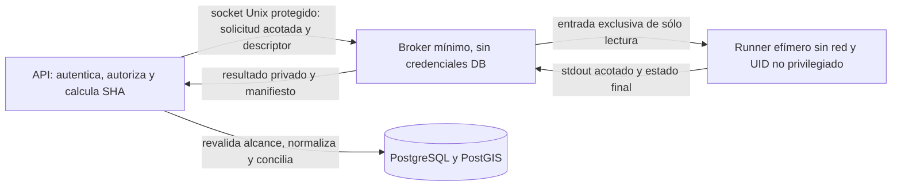

# SS-02 etapa 2 — Diseño de worker GIS aislado

Fecha: 2026-10-28. Software-PA / SSALFER, referencia dev 683ff75613768de28a7127c7e33a6e2ef4fc40ff más cambios locales SS-01/SS-03 y SS-02 etapa 1.

**Propuesta técnica, no implementada.** No hay nuevo servicio, contenedor, volumen, endpoint, migración ni dependencia en esta entrega. SS-02 continúa abierto hasta validar la frontera efectiva.

## Recomendación concreta

Adoptar un **broker de trabajos de alcance mínimo y runners efímeros, un contenedor por importación**, separados de la API. Cada runner ejecuta sólo inspección/conversión GDAL de un archivo o Shapefile ya validado, sin credenciales de DB, red o acceso a uploads/documentos de otros trabajos. El backend conserva RBAC, conciliación, validación PostGIS y persistencia. El broker supervisa cuotas, deadline, cancelación y lifecycle; nunca ejecuta contenido GIS él mismo.

Esta opción requiere mayor operación que un worker persistente pero evita que un parser comprometido permanezca para leer trabajos posteriores o inspeccione archivos simultáneos del mismo UID. Se recomienda un usuario/daemon rootless dedicado a runners si el host lo soporta. La alternativa de broker con acceso al Docker daemon privilegiado añade un componente con facultades equivalentes a administración del host y requiere revisión explícita; no se debe ocultar ese riesgo detrás de un montaje docker.sock de sólo lectura.

## Alternativas evaluadas

| Alternativa | Ventaja | Límite | Decisión |
|---|---|---|---|
| Subproceso en la API con env filtrado | Cambio pequeño y compatibilidad actual | Mismo UID/filesystem/proc; etapa 1 no es aislamiento fuerte | Sólo mitigación transitoria |
| Worker persistente en contenedor sin red | Menor complejidad, imagen única | Procesos del mismo UID, trabajos concurrentes y restos entre trabajos; no montar todos los uploads | Alternativa intermedia con un trabajo activo, reciclaje completo y aceptación explícita de residuales |
| Runner efímero por trabajo + broker mínimo | Filesystem por trabajo, sin estado entre importaciones, cgroups por job y cancelación fiable | Orquestación y reconciliación de lifecycle; privilegios del broker | **Recomendada** |
| Cola/RPC remota sobre red | Escala y desacopla nodos | Requiere infraestructura, credenciales/mTLS y políticas nuevas | Evaluar sólo si aparece necesidad real, no asumir que ya existe |

## Fronteras y comunicación

API y broker se comunican por socket Unix en volumen exclusivo, con permisos de grupo mínimos y verificación del UID peer (SO_PEERCRED). La red Docker de la aplicación no es el mecanismo de autenticación del broker. Entregar la entrada mediante un descriptor abierto sólo lectura y un protocolo acotado evita permitir rutas arbitrarias del host. Si se adopta comunicación entre nodos, sustituir por mTLS e identidad de servicio con expiración; esos secretos pertenecen al backend/broker, **nunca al runner**.

Solicitudes admiten job_id generado por servidor, hash/tamaño esperado, perfil/versiones de procesamiento y opciones enumeradas. No admiten comando, shell, imagen, mounts, env libre, ruta de salida ni URLs suministradas por el cliente. Broker verifica esquema, límites y credenciales peer, copia el descriptor a su raíz privada de jobs, comprueba tamaño/hash y fija él mismo ruta y orden de ejecución. No toma decisiones RBAC del usuario final; el backend autoriza enviar, consultar y cancelar según política existente.

No montar docker.sock en API ni runner. El broker sólo accede a la instancia runner dedicada y ejecuta una plantilla inmutable validada, con imagen por digest y rutas dentro de su propia raíz. Usar daemon rootless/usuario separado cuando sea viable, sin puertos administrativos publicados. La compatibilidad rootless, cgroups, perfiles y permisos del host debe verificarse; no se asume habilitada en Ubuntu actual.

## Identidad, filesystem y secretos

- Imagen runner contiene GDAL/OGR/PROJ, sus librerías y rejillas locales; no contiene código API, .env, clientes de administración, claves ni datasets reales. Versiones por digest/SBOM y pruebas del corpus QA.
- UID/GID no privilegiados diferentes del backend, sin capabilities añadidas, cap_drop ALL, no-new-privileges, seccomp/AppArmor revisados, root filesystem read-only. No usar privileged, host PID/network/IPC ni mounts del host amplios.
- Broker crea un directorio aleatorio por trabajo bajo su raíz, 0700, sin reutilizar nombres del cliente; entrada regular con permisos mínimos, estable e inmutable. El mount del runner muestra **sólo esa entrada** como read-only, no todo UPLOAD_ROOT. No incluye expediente documental ni otros jobs.
- ZIP se inspecciona/extrae dentro del ámbito restringido del runner usando los presupuestos de SS-03. La expansión queda en tmpfs o volumen privado por job con cuota, sin enlaces externos y sin montaje compartido con jobs ajenos.
- Scratch/tmp/config/home privados por job; no compartir /tmp entre runners ni caché escribible de PROJ. Rejillas, proj.db y recursos de GDAL read-only y de confianza. El entorno explícito de etapa 1 se adapta a esas rutas fijadas por perfil, sin copiar variables de API/broker.
- Salida por stdout binario/GeoJSONSeq acotado, más estado final/manifiesto de versión/conteos/CRS. No aceptar rutas ni SQL del runner. Si se usa spool, broker crea el archivo de forma exclusiva y verifica regularidad/propiedad/cuota antes de entregarlo al backend.

Un runner comprometido puede falsear su salida o agotar su presupuesto; la API debe validar todo resultado. Contenedores comparten kernel: host actualizado y aislamiento de nodo/VM para riesgo superior siguen siendo decisiones de infraestructura, no garantías del parser.

## Red y drivers

Runner con red none, sin DNS/host routes/puertos publicados ni sockets de servicios institucionales montados. Sólo stdio gestionado por broker; no conectar al bridge de PostgreSQL ni al proxy. PROJ usa rejillas locales; no descargar al procesar una carga.

Mantener GeoJSON, KML o LIBKML, GPKG y ESRI Shapefile de entrada, más GeoJSONSeq de salida y dependencias necesarias para WKB/SQL SQLite. Inventariar drivers reales y bibliotecas, probar KML/LIBKML y auxiliares Shapefile antes de recortar. Preferir un build mínimo revisado y apertura restringida antes del primer Open mediante wrapper GDALOpenEx permitido o CLI compatible. Las listas skip son exclusiones dependientes del build; no constituyen por sí mismas una allowlist completa ni cubren aperturas internas de otros drivers.

Los accesos a recursos remotos/locales indirectos dentro de KML/GPKG/otros drivers deben probarse con destinos de laboratorio controlados **dentro del sandbox**, verificando que no salgan a red ni a ficheros ajenos. No probar payloads contra servicios reales. La ausencia de CURL o PROJ_NETWORK=OFF no sustituye el namespace de red.

## Recursos, cancelación y lifecycle

Aplicar memoria/swap, CPU, PID, tamaño de scratch/spool/entrada/salida y deadline total por job desde broker/daemon. Conservar todos los límites SS-03 y la cuenta observada; no truncar para convertir un exceso en éxito. Elegir valores de RAM/CPU/deadline con mediciones QA y objetivos institucionales aprobados; no se inventan cifras de capacidad del host. El tamaño de tmpfs cuenta en el presupuesto de memoria y la expansión JSON/WKB/ORM requiere margen medido.

Deadline con reloj monotónico supervisado fuera del parser, cubriendo inspección + extracción + conversión. Timeout del proceso no basta si un hijo está bloqueado o ignora cancelación. Broker envía cancelación, aplica gracia acotada, mata y espera la finalización del contenedor/cgroup completo, después elimina temporales propios. Cualquier stdout parcial se marca fallido y se descarta; sólo el resultado validado con estado final exitoso pasa al backend.

El broker mantiene un registro mínimo persistente de job_id, dueño lógico/referencia, digest, timestamps, perfil y estado, sin payload sensible. Estados propuestos: recibido, ejecutando, resultado_listo, fallido, cancelado, consumido/expirado. En reinicio, reconcilia registro con containers etiquetados exclusivamente como suyos; no mata ni borra recursos de otra aplicación. Define TTL y recolección con leases para no eliminar un resultado en consumo, y cuotas de cola/concurrencia por usuario/proyecto más una cuota global.

La representación durable de trabajos y compatibilidad de esquema, si resultan necesarias, requieren diseño y autorización de migración nueva. No modificar migraciones históricas. No exponer rutas, stdout completo, tokens ni trazas de librerías en logs; registrar códigos, conteos, hashes técnicos y correlación con job_id.

## Separación de transacciones y operación síncrona

Hoy se mantiene un lock de proyecto durante staging/conciliación y GDAL bloquea el event loop. No trasladar simplemente la llamada a una RPC esperando dentro de esa misma transacción.

1. Transacción corta de autorización/estado: comprobar usuario y proyecto activos, configuración GIS y compatibilidad de solicitud; terminar antes de parsear. Guardar referencia de versión de configuración requerida y hash de entrada.
2. Enviar al broker sin conexión/lock de BD retenidos. Ejecutar fuera del event loop; idealmente API de job asíncrono con consulta/cancelación. Un adaptador síncrono transitorio debe liberar transacción y usar espera no bloqueante con deadline, sin prometer resultado inmediato.
3. Recibir salida completa y acotada en staging privado. El backend valida esquema de metadata/Feature, tipos, conteos, tamaño y hash/identidad de entrada. No confiar en que el worker haya obedecido el protocolo o conserve geometrías.
4. Antes de persistir, revalidar sesión/rol/alcance/proyecto y estado/configuración GIS vigentes. Adquirir locks en el orden actual proyecto → importación y repetir idempotencia; si cambiaron SRID/universo/versión, rechazar o replanificar explícitamente, sin aplicar resultado obsoleto.
5. Ejecutar normalización PostGIS, SAFE_FIELDS, conciliación y decisiones bajo los contratos actuales; commit atómico. Confirmar consumo al broker después del commit y liberar spool. Un fallo no publica una importación completa ni cambia decisiones históricas.

La salida GDAL puede llevar geometry original/WKB y CRS fuente, sin eliminar Z/M; mantener extracción lossless, 4326/CRS de trabajo, SHA-256, procedencia, conteos, alcance completo/parcial e idempotencia. Si el contexto administrativo cambió durante un job, recalcular matching contra el contexto autorizado correcto; no aceptar ciegamente una conciliación antigua. La confirmación y el historial permanecen en la API/DB, el worker no decide autorizaciones ni estados de negocio.

## Compatibilidad con Docker Compose existente

Proponer después un archivo separado de configuración de broker/runner o un servicio de host dedicado, sin cambiar los perfiles dev/prod por sorpresa. La API, SSALFER, PostgreSQL y pgAdmin conservan sus servicios; el runner no hereda el anchor x-backend-environment, ni networks o volumes del backend. El broker tiene su socket/raíz de jobs exclusivos; el runner usa la plantilla fija por job y no se construye desde todo backend/ para evitar copiar secretos/código.

Compose no proporciona por sí solo un planificador seguro de jobs efímeros. El broker supervisado debe crear/recolectar runners de forma controlada o delegarlo a un orquestador de jobs ya autorizado; no dar al usuario HTTP la capacidad de configurar Docker. Separar permisos de build, operación y acceso a resultados. Verificar recursos efectivos de los contenedores y compatibilidad de rootless/cgroups/Ubuntu antes de desplegar. No ejecutar comandos de creación/build/restart durante la revisión de este diseño.

## Criterios de aceptación de etapa 2

| Área | Evidencia exigida en QA desechable |
|---|---|
| Secretos | Sentinel sólo en API/broker, ausente del env/imagen/mounts/logs del runner; tampoco puede leer proc/archivos API |
| Filesystem | Job A no puede leer/escribir job B ni documentos; entrada de sólo lectura, scratch privado y cuota efectiva |
| Red | Intentos a destinos de laboratorio no salen del runner; sin acceso a DB/proxy/host metadata; namespace y rutas constatados |
| Recursos | Exceso de RAM/CPU/PID/bytes/deadline produce fallo y cancelación del cgroup; servicio API sigue disponible |
| Drivers | Corpus nativo GeoJSON/KML/GPKG/ZIP-SHP/GeoJSONSeq y rejillas locales compatibles, aperturas externas denegadas |
| Integridad | CRS/Z/M/WKB/hash, matching, versiones, completo/parcial e histórico iguales en fixtures; salida manipulada o parcial rechazada |
| Concurrencia | Repetición de job, cambios de rol/proyecto/SRID, revocación y confirmación concurrentes sin permisos obsoletos ni doble commit |
| Recuperación | Caída API/broker/runner, disco lleno y reinicio dejan estados coherentes; limpieza sólo de recursos propios |
| Canal | Rechazo de peer no autorizado, replay/IDs ajenos y solicitud con imagen/comando/path/env extra; cuotas de cola |

La revisión de criterios define cómo medir; no acredita que esos ensayos hayan sido ejecutados. La migración a jobs debe conservar los tests existentes y añadir los anteriores antes de retirar GDAL del backend. Cambios de API/persistencia requieren revisión de compatibilidad con SSALFER y aprobación independiente.

## Referencias y alcance de decisión

La [documentación de red none de Docker](https://docs.docker.com/engine/network/drivers/none/) sustenta separar la conectividad del runner; las [restricciones de recursos](https://docs.docker.com/engine/containers/resource_constraints/) requieren configuración explícita y soporte del host. La recomendación de broker/rootless/runner por job y el protocolo son decisiones de este diseño, no configuración ya existente ni una garantía automática de Docker.

La [guía de seguridad de GDAL](https://gdal.org/en/stable/user/security.html) respalda tratar incluso la apertura de datasets como procesamiento hostil; por eso los controles deben existir antes de inspeccionar el formato. Los detalles de [drivers/configuración](https://gdal.org/en/stable/user/configoptions.html) y [recursos PROJ](https://proj.org/en/stable/usage/environmentvars.html) se verificarán contra las versiones empaquetadas, no contra una supuesta versión del servidor.

**Estado: diseño para revisión. No se implementa etapa 2, no se cierra SS-02 y no se inicia otro hallazgo.**
