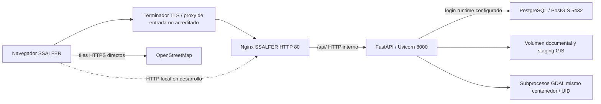

# SS-08 etapa 1: inventario de despliegue y límites de confianza

Fecha: 2026-10-29. Fuente: archivos versionados y cambios locales sobre `dev`/`683ff75613768de28a7127c7e33a6e2ef4fc40ff`. **No se ejecutaron Compose, Docker, Nginx, conexiones o comandos de inspección institucional.** Los valores `${...}` son referencias/defaults del archivo, no valores de .env leídos.

## Recorridos conocidos y pendientes

No hay listener443/certificado/terminación HTTPS en ninguno de los Nginx revisados. El origen HTTPS público, edge y red hasta el host no están acreditados. Frontend/API comparten origen si el navegador usa env.js=/api y se entra por el Nginx correcto. Acceso directo al backend y entrada React/Vite son recorridos distintos.

## Servicios Compose principales

Todos carecen de USER/cap_drop/no-new-privileges/read_only/recursos explícitos de endurecimiento en los archivos revisados, salvo los mecanismos internos que pueda aplicar la imagen. Esto no prueba el UID/privilegios efectivos del contenedor existente. No se activan restricciones genéricas en esta etapa.

| Servicio | Imagen/build y comando declarado | Publicación de host | Persistencia/temporales | Salud/reinicio/logs declarados |
|---|---|---|---|---|
| db | postgis/postgis:15-3.3; inicialización/migraciones montadas read-only |127.0.0.1:${DB_HOST_PORT:-5433} →5432 |postgres_data; init/migraciones/runner :ro. PGDATA debe permitir escritura |pg_isready; restart always; json-file default10m ×3 heredado. No acredita autenticación/privilegios/backup |
| pgadmin |dpage/pgadmin4 sin tag explícito |127.0.0.1:${PGADMIN_HOST_PORT:-5050} →80 |pgadmin_data; configuración/sesiones escribibles |HTTP healthcheck; restart always; logs rotados por configuración común. Identidad web no equivale a usuario PostgreSQL |
| backend |python:3.11-slim con GDAL/libpq/gcc; imagen software-pa-backend |127.0.0.1:${BACKEND_HOST_PORT:-8000} →8000 |uploads_data:/app/uploads; GIS bajo uploads/importaciones; staging SS-12 privado; /tmp para multipart/reportes/otros temporales |health consulta BD/schema_migrations; restart always; logs SS-10 y json-file acotado. Compose base ejecuta sin reload y con --no-proxy-headers |
| frontend |React/Vite: node:22-slim para dev/build; nginx:1.27-alpine en producción |Base no publica puerto; override/prod lo añaden |Dev: bind ./frontend y volumen anónimo node_modules; prod sirve dist |restart always; logs comunes; health depende de variante. No se presume retirado |
| frontend_ssalfer |nginx:1.27-alpine, build ./frontend-ssalfer/deploy/Dockerfile |127.0.0.1:${SSALFER_HOST_PORT:-5174} →80 |Sin mount de uploads ni de BD; sólo assets seleccionados. Nginx requiere sus directorios de cache/body-temp/proxy-temp/PID y quizá escrituras de entrypoint |restart always y espera backend saludable; **sin healthcheck propio ni logging rotado explícito** en ssalfer.yml. Access log nuevo mínimo; rotación/collector efectivo pendientes |

El prefijo127.0.0.1 reduce exposición directa de los puertos publicados al host local, según Compose; no demuestra firewall, túneles, proxy del host o daemon efectivos. No se ejecutó compose config: resolver/interpolar podría revelar secretos. No hay docker.sock, modo privilegiado o host networking declarados en los servicios principales; tampoco prueba de aislamiento efectivo por host.

## Variantes y combinaciones

| Combinación declarada | Consecuencia conocida / pendiente |
|---|---|
| Uso de Compose sin -f explícitos | Puede combinar automáticamente docker-compose.override.yml de desarrollo: backend --reload, binds y frontend Vite5173; no apropiarlo como manifiesto de producción |
| Base + prod |APP_ENV=production, Secure=true, CORS explícito; React frontend target production y puerto5173→80. Sigue sin describir TLS externo ni añadir por sí solo SSALFER |
| Base + ssalfer |Añade otro servicio, no reemplaza frontend React. Backend queda con defaults de entorno development salvo overrides externos; cookie Secure no queda garantizada |
| Base + prod + ssalfer explícitos |Candidato a desplegar ambos frontends con backend production, sin override automático de dev. Requiere renderizado seguro autorizado, CORS/origen, TLS/puertos y manifiesto exacto revisados; no ejecutado |
| backend/Dockerfile usado sin comando Compose |CMD conserva --reload. No cambiarlo silenciosamente como parte del proxy; exigir comando/imagen efectiva QA y revisión antes de producción |
| Composes bajo backend/tests |Instancias declaradas para QA desechable con workers/datos sintéticos, no despliegue principal; uno declara red internal y otro depende de su entorno. No se ejecutaron ni se reproducen sus valores de autenticación |

No hay redes explícitas en los cuatro Compose principales: usan la red default del proyecto, compartida por API, DB, pgAdmin y frontends. No está marcada internal y no hay separación egress ni worker GIS independiente. Un frontend sin credenciales DB puede tener conectividad de red al servicio db; no atribuir a la ausencia de credenciales una barrera de red.

Tags de imágenes mutables/no fijados por digest, paquetes apt no congelados y toolchain de compilación en backend son riesgos de construcción/huella a revisar con SS-09; no se cambian dependencias o versiones en SS-08. No hay límites de memoria/CPU/PIDs/ulimits/concurrencia explícitos. No se inventa el dimensionamiento del host para introducirlos.

## Proxies y autenticación SS-04

Nginx SSALFER preserva exactamente los cuatro proxy_set_header originales:

- Host `$host`.
- X-Real-IP `$remote_addr`.
- X-Forwarded-For `$proxy_add_x_forwarded_for`.
- X-Forwarded-Proto `$scheme`.

Uvicorn conserva --no-proxy-headers en Dockerfile y comandos Compose. FastAPI recibe el peer TCP real del salto que le conecta; `resolve_client_ip` sólo usa una cadena XFF válida si ese peer está en AUTH_TRUSTED_PROXY_IPS exactas, recorriendo de derecha a izquierda hasta el primer salto no confiable. No se confía en la primera IP recibida del usuario ni en subred Docker completa. La lista por defecto es vacía, no evidencia de proxy confiable.

En varios saltos, cada proxy administrado debe añadir su peer real o sobrescribir con una cadena previamente verificada; el edge no debe convertir el XFF del cliente en una identidad validada. Determinar direcciones reales/estables del Nginx y de cada edge con QA, no inferirlas de nombres DNS Docker o de una variable. Si el peer de API no es confiable, se conserva como identidad observada y no se inventa la IP externa.

Forwarded y otros X-Forwarded-* del cliente no se convierten aquí en autoridad. --no-proxy-headers impide también confiar automáticamente en X-Forwarded-Proto; la cookie Secure viene de configuración backend, no del esquema ASGI. Nginx sólo ve http cuando TLS terminó antes de él y sobrescribe XFP con ese valor. `$host` no conserva necesariamente el puerto de Host, y las redirecciones automáticas de slash/URLs absolutas pueden observar http/host sin puerto. **Riesgo conocido de SS-04 no corregido ni ocultado**.

Diseño pendiente: fijar host/esquema/origen público en el edge administrado, rechazar Host no autorizado, normalizar cabeceras y redirecciones de forma explícita. Si se modifica cómo FastAPI conoce HTTPS, debe ser un diseño separado de confianza de esquema, revisado con SS-04, sin reactivar --proxy-headers indiscriminadamente. Probar tanto rutas canónicas como slash/Location y URL generada.

Cookies __Host- requieren Secure, Path=/ y ausencia de Domain; session HttpOnly y cookie CSRF legible se mantienen. SameSite lax/strict, expiración/revocación, Origin y X-CSRF-Token permanecen en backend. CORS tiene allow_credentials y orígenes explícitos; el defaultlocalhost5173 no incluye automáticamente SSALFER5174 ni HTTPS institucional: comprobar configuración de origen antes de ensayar login. No cambiar autenticación para compensar una entrada HTTP mal configurada.

## Contenedores: propuesta por compatibilidad, no aplicada

| Control | Evidencia local / razón para no imponerlo ahora | QA y dependencia |
|---|---|---|
| Usuario no privilegiado |No USER propio en Dockerfiles; Nginx suele separar master/workers y Postgres tiene entrypoint propio. UID efectivo desconocido |Inventariar proceso/UID/GID/umask; probar permisos de SS-12, uploads/GIS y backup. No hacer chmod/chown masivo |
| cap_drop / no-new-privileges |No declarados; entrypoints/master pueden necesitar transiciones/permisos de puerto o directorios |Probar por servicio e imagen, con las capacidades estrictas necesarias, no drop ALL ciego |
| read_only |DB, pgAdmin, API/GDAL/Nginx necesitan rutas escribibles concretas |Definir volúmenes/tmpfs/propietarios/tamaño y crash recovery; evitar convertir uploads en tmpfs sin persistencia |
| Aislamiento red |Default compartida; tiles cliente a proveedor externo |Diseñar redes/egress y worker con SS-02 etapa2; DNS/DB/API/descargas deben seguir funcionando |
| GDAL |Entorno restringido SS-02 y presupuestos SS-03, pero mismo UID/filesystem/secretos accesibles por proceso comprometido |Worker aislado y límites de SO pendientes. No declarar resuelto por headers, CSP o variables de entorno |
| Almacenamiento |SS-12 usa staging/no-replace/sha, conserva publicados ante commit incierto; no atomicidad BD/FS |Validar volumen compartido, hardlinks/fsync y recuperación; locks PostgreSQL/TOCTOU de descarga pendientes |
| Secretos |Envrefs en Compose; sin lecturas de .env. Backend Dockerfile COPY . y dockerignore no excluye expresamente futuros .env internos |Revisar build/secrets/daemon con SS-09; no imprimir docker inspect/env ni compose config sin filtrado/autorización |
| Logs |Backend SS-10 seguro; nuevo access log Nginx mínimo; error log sigue formato nativo |Proteger error logs y collector, rotación/cuotas/retención; frontend_ssalfer no hereda logging del otro servicio por ser nuevo |
| Salud/restart/recursos |Health/restart declarados en varios servicios; SSALFER sin healthcheck propio; no recursos fijados |Probar fallos y tamaño host/carga real en QA. No equiparar restart always con disponibilidad o cancelación SQL/GDAL |

**No se cambia Compose, backend, UID, capacidades, redes, volúmenes ni límites de recursos en esta etapa.**
